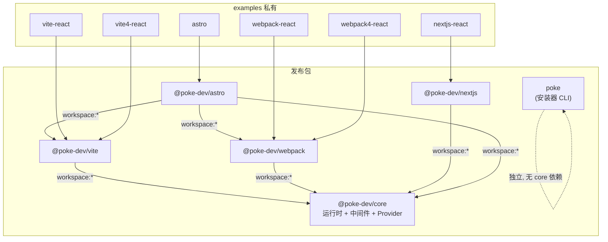
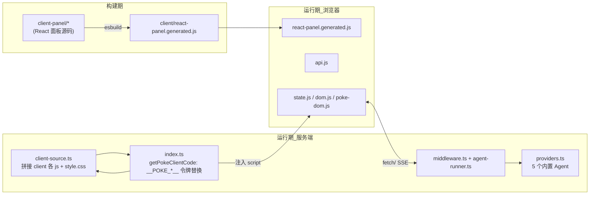
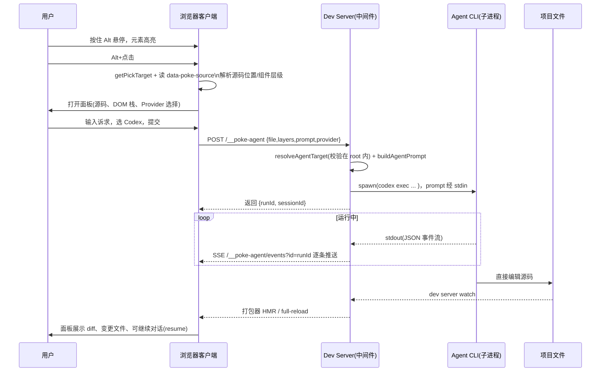
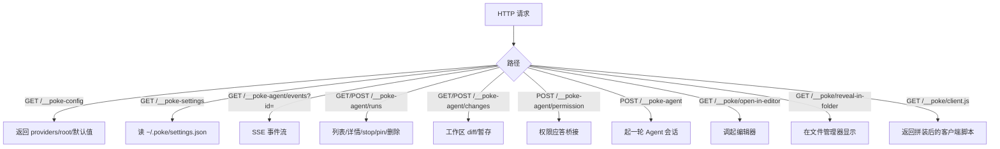
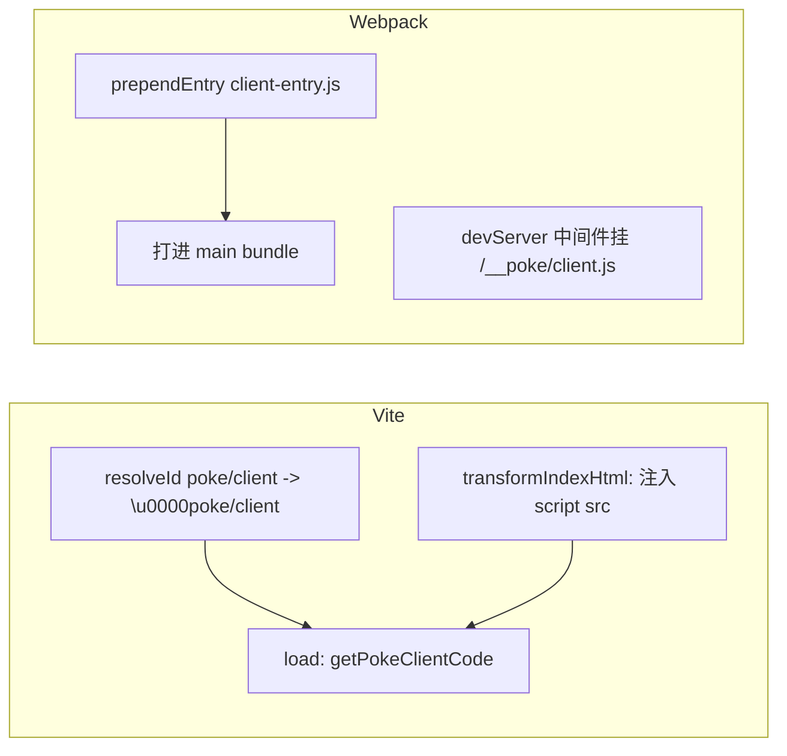
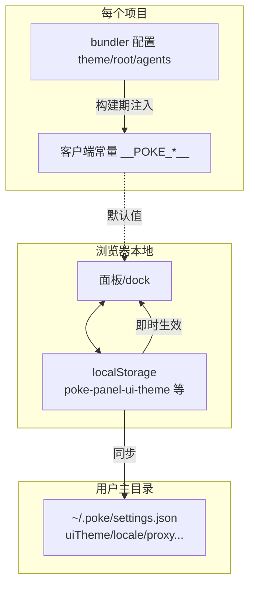

# Poke 架构设计（ARCHITECTURE）

## 1. Monorepo 分包与依赖

pnpm workspace，`packages/*` 为可发布包，`examples/*` 为私有冒烟工程。所有发布包用 changesets 统一锁版本（fixed 组）。

要点：
- **core 是唯一逻辑源**：客户端拼装、HTTP 中间件、Provider 定义都在 core；各打包器插件只是「把 core 的中间件挂到 dev server、把 core 生成的客户端脚本注入页面」的适配器。
- **cli（`poke`）刻意零运行时依赖**：它只用 Node 内置模块改写配置文件，安装时不应把 core 拖进来。

## 2. core 内部分层

## 3. 全链路时序：拾取 → 注入 → Agent 会话 → 热更新

## 4. 中间件协议

core 暴露 `createPokeMiddlewares(root, options)`，各插件把它挂进自己的 dev server。路由一览：

| 路由 | 方法 | 职责 |
| --- | --- | --- |
| `/__poke-config` | GET | 客户端启动时拉取可用 Provider、root、默认代理 |
| `/__poke-settings` | GET | 读取用户全局设置（`~/.poke/settings.json`） |
| `/__poke-agent` | POST | 新建会话或在既有会话上追加一轮（resume） |
| `/__poke-agent/events` | GET | SSE：把 Agent 子进程输出实时推给面板，支持 `since` 游标重放 |
| `/__poke-agent/runs` | GET/POST/DELETE | 会话列表/摘要/停止/置顶/删除，按 root 隔离 |
| `/__poke-agent/changes` | GET/POST | 工作区未提交变更清单与单文件 diff，支持暂存 |
| `/__poke-agent/permission` | POST | 权限模式（ask）下 Agent 审批的桥接回环 |
| `/__poke/open-in-editor` `/__poke/reveal-in-folder` | GET | 源码位置跳转编辑器 / 定位文件（挂在 `/__poke/` 命名空间下，避免与宿主 dev-server 的 `/__open-in-editor` 路由冲突） |

> Vite 侧客户端脚本走 `/@id/__x00__poke/client` 虚拟模块；Webpack 侧额外挂 `/__poke/client.js`。插件路径前缀均可由 `clientPath` 覆盖。

## 5. 客户端注入机制

- Vite：`enforce:'pre'`、`apply:'serve'`，虚拟模块 `\0poke/client` 由 `load` 返回客户端源码，`transformIndexHtml` 注入 `<script type=module src=/@id/__x00__poke/client>`。
- Webpack：非 production 下把 `client-entry.js` 前置进 entry，并把 `/__poke/*` 中间件挂到 dev server（v5 用 `setupMiddlewares`，v4 用 `before`）。注意 vue-cli-service 会在插件 `apply()` 前就快照 `devServer`，插件自己设的 `before` 不被调用；这类宿主需在 `vue.config.js` 的 `devServer.before` 里调 `pokeDevServerBefore()(app, server)` 手动挂路由（否则 client-entry 的 `<script src=/__poke/client.js>` 404，图标/快捷键不生效）。
- **源码属性注入按框架/打包器分流**：注入属性统一为 `data-poke-source`（`文件:行:列`）与 `data-poke-source-range`。Vite 用 `transform` 钩子（JSX via babel、Vue via `compiler-sfc`、Svelte via compiler，天然懒编译、每模块一次）。Webpack 分两类：React JSX 用 `source-loader.cjs`（babel），但**按宿主能否解析 `react` 门控**——非 React 项目（Vue JSX / Solid 的 `.jsx`）完全不碰，避免把 JSX 改写成 `import … from 'react/jsx-runtime'` 而编译失败（可用 `annotateJsx` 强制开关）；Vue2/webpack4 的 `.vue` 用 `vue-source-loader.cjs`（`enforce:'pre'`，先于 vue-loader）解析 SFC 给模板节点补坐标，并按 `resourcePath + source` 记忆化，消除 vue-loader 每文件多子请求触发的全量重解析（实测 1201 个 `.vue` 冷启动 ~16s→~4s，坐标与产物不变）。

## 6. 状态与持久化边界

三层各司其职：bundler 配置给**默认值**；`localStorage` 让**即时切换**不依赖服务端；`~/.poke/settings.json` 是跨项目的**用户级偏好**（由面板写回，`api.js` 的 `userSettingFields` 做字段映射）。
