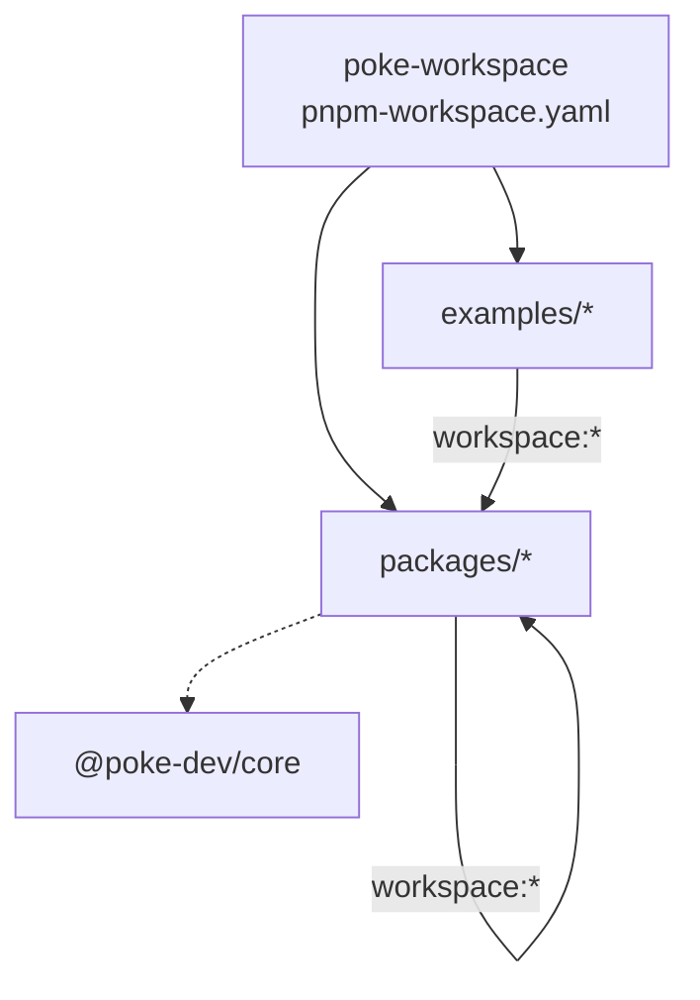
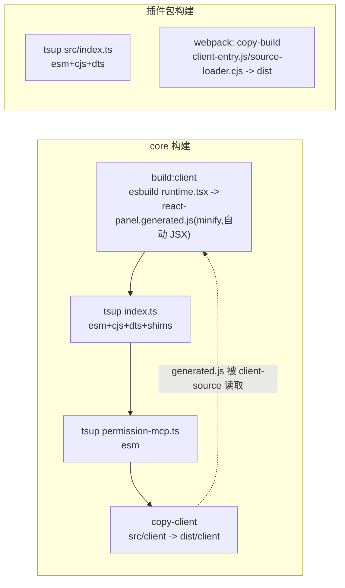
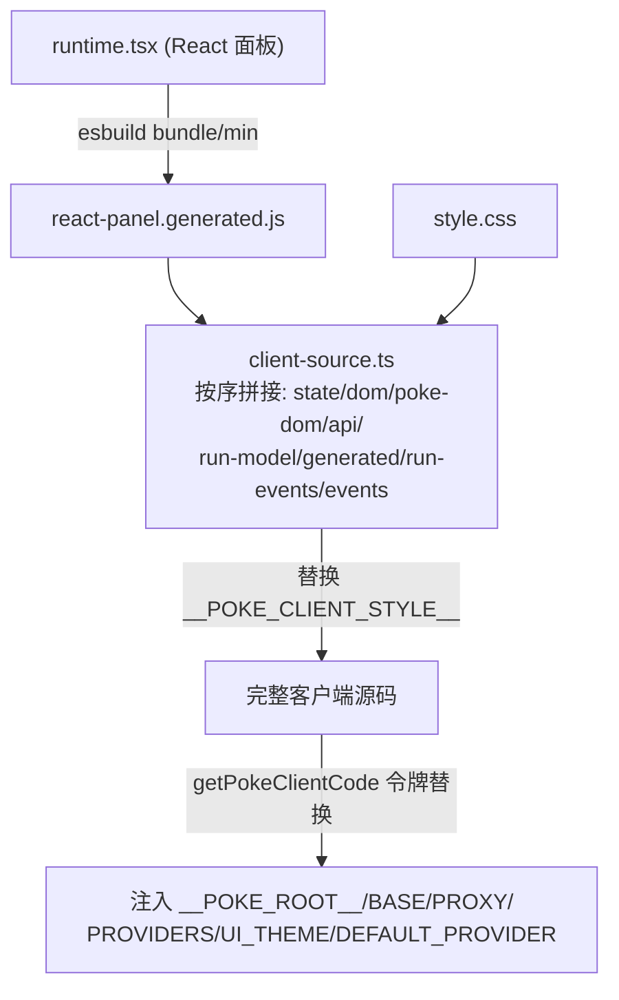
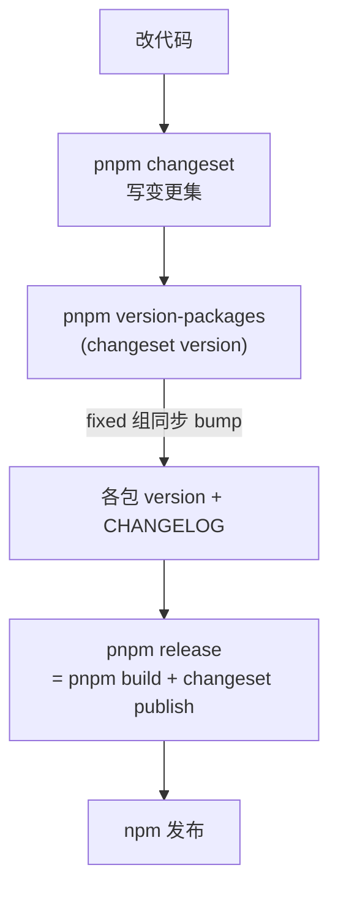
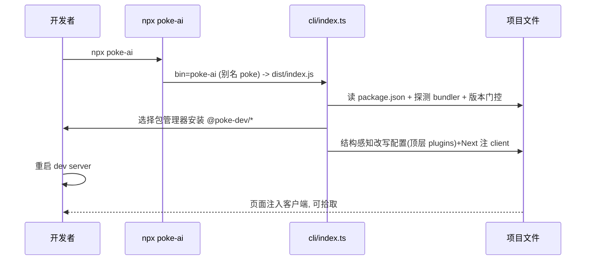

# Poke 构建与发布（BUILD-AND-RELEASE）

## 1. 环境与包管理

- 包管理器锁定 `pnpm@10.33.2`（根 `package.json` 的 `packageManager`）。
- 本仓库以 git worktree 承载分叉，主 `main` 不受影响；`build`/`typecheck`/`test` 都只作用于 `./packages/*`（示例工程不参与发布门禁）。

## 2. workspace 解析

## 3. tsup 构建管线

每个包用 tsup 产出 ESM/CJS + d.ts；core 额外产出浏览器端产物并拷贝 client 目录。

要点：
- **`react-panel.generated.js` 是构建产物**：`client-panel/runtime.tsx` 经 esbuild 打包（`--format=esm --platform=browser --jsx=automatic --minify`）后落到 `src/client/`，再由 `client-source.ts` 与其它 `client/*.js`、`style.css` 拼成单一 IIFE 段。
- **`copy-client` / `copy-build`**：把非 tsup 管辖的裸文件（client 运行脚本、webpack 的 entry/loader）原样拷进 `dist`，保证发布包自包含。
- **`getBundledAssetPath`**：运行时优先取 `src/`（monorepo 内开发），回退 `dist/`（发布后），因此 loader/entry 路径在两种形态下都解析正确（webpack4 亦然）。

## 4. 客户端源码生成流程

`getPokeClientCode` 的令牌替换发生在**服务端每次响应时**，因此 `theme`、`root`、Provider 列表等能随配置动态生效，无需重建包。

## 5. changesets 版本与发布

- `.changeset/config.json` 的 `fixed` 组把 `poke-ai`、`@poke-dev/core|vite|webpack|nextjs|astro` 锁成**同版本联动**。
- `ignore` 列出全部 `@poke-dev/playground-*` 示例（含 `webpack4`/`vite4`），加上示例本身 `private:true`，双重保证示例不进发布流。

## 6. npx 使用路径（安装 → 运行）

安装步骤（`runInit`）：解析参数 → 读 `package.json` → `detectBundler`（依赖+配置文件双重探测，Astro 优先吞掉 vite）→ `resolveConfigFile` → 安装对应包 → 调 `patchXxxConfig` 改写配置 → 提示重启。详见 `INSTALLER-DESIGN.md`。

## 7. 验证矩阵（本分叉实际执行）

| 环节 | 命令 | 结果 |
| --- | --- | --- |
| 基线 | `pnpm build` / `typecheck` / `test` | 67 测试通过（core）+10（cli） |
| 改名 | `pnpm brand:apply` 后重建 | `pnpm brand:check` 0 残留 |
| 安装 | `npx poke-ai --no-install` on postcss 嵌套 webpack | 写入顶层 plugins |
| 版本门控 | 临时夹具 vite^3 / vite^4 / webpack+ds^2 | 退出1不改配置 / 正常改写 / 阻断 dev-server |
| webpack4+ds3 | `pnpm dev:webpack4` | 路由 200、client.js 200、拾取属性出现 |
| vite4 | `examples/vite4-react` dev | 路由 200、虚拟模块加载、transform 注入 |
| webpack5 回归 | `examples/webpack-react` dev | 编译成功、路由 200（无回归） |
