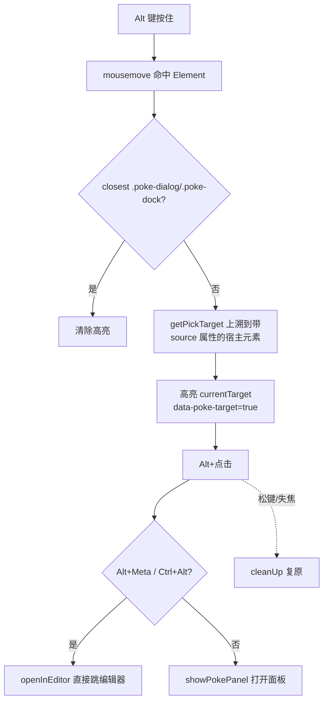
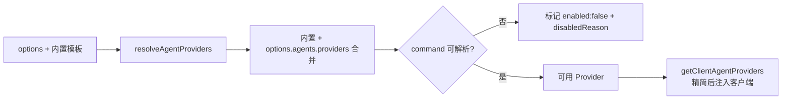
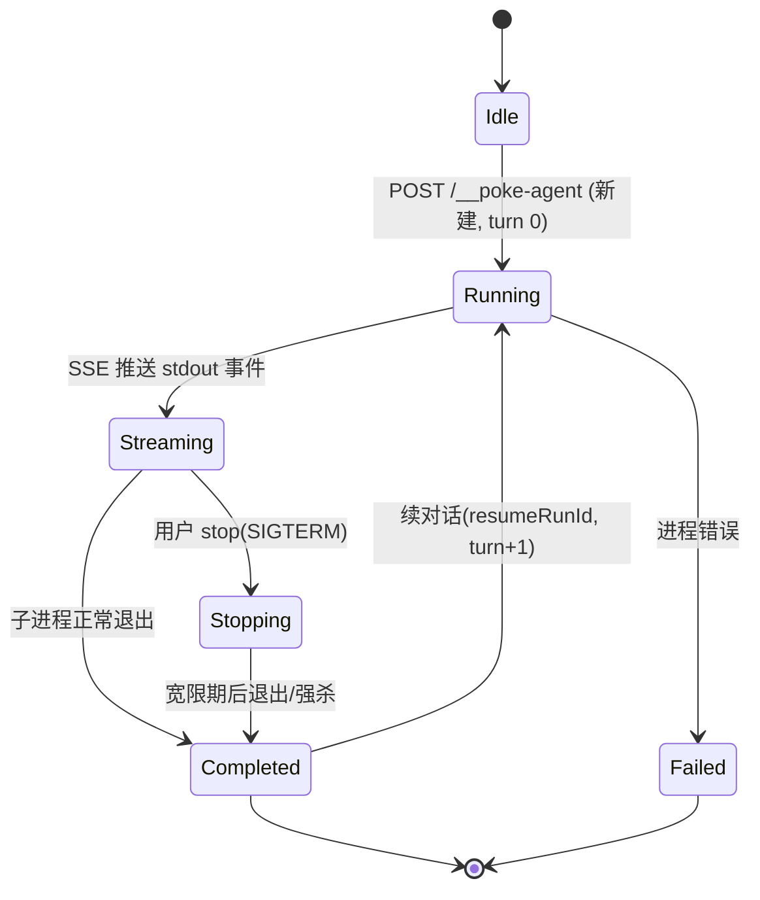
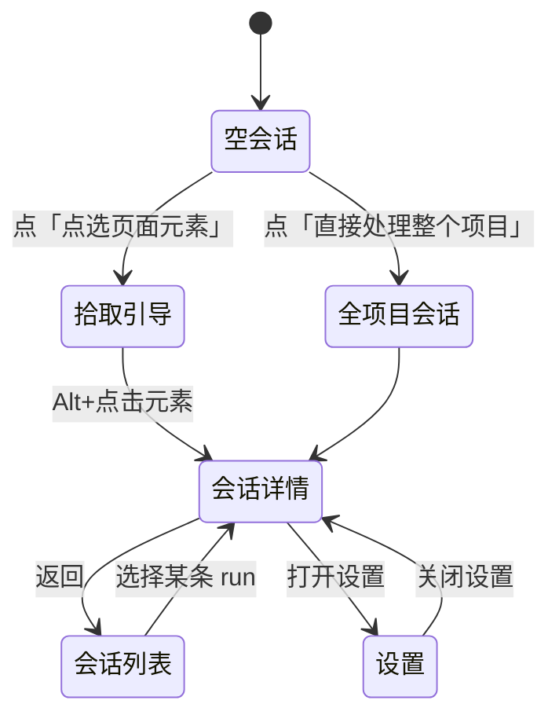
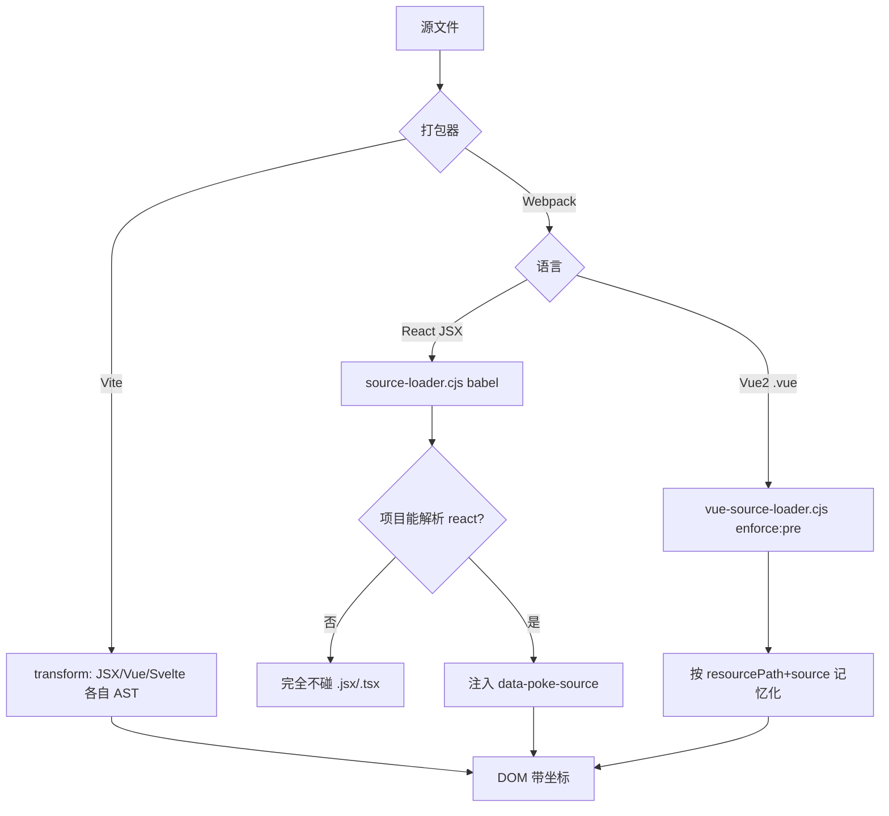
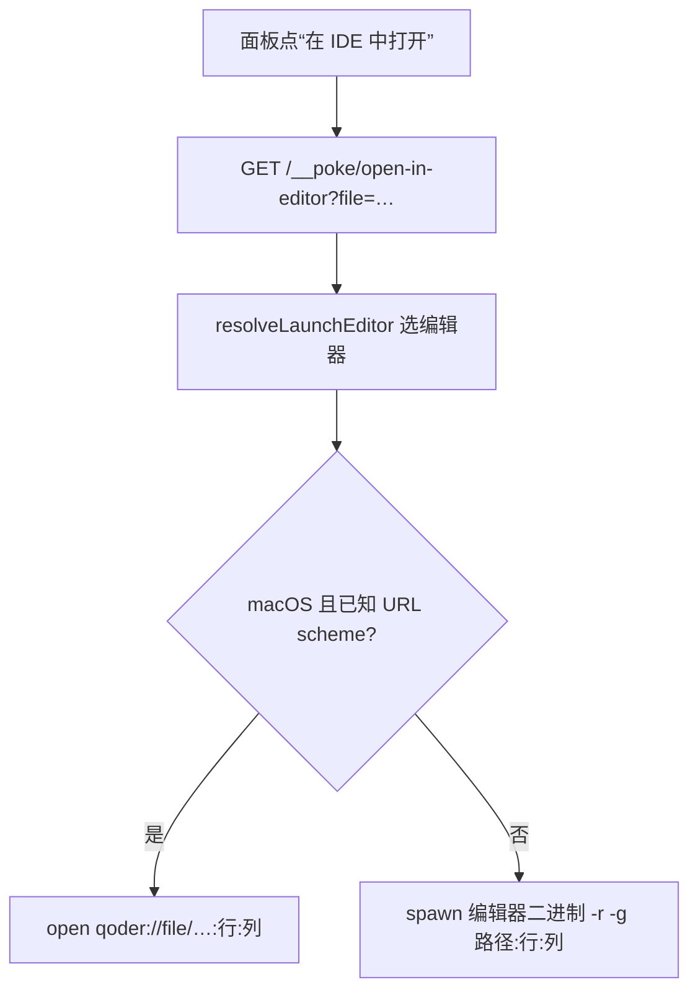

# Poke 功能设计（FEATURE-DESIGN）

## 1. 元素拾取

拾取不依赖运行时改写 DOM，而是**编译期**给 JSX/模板元素注入 `data-poke-source`（`文件:行:列`）与 `data-poke-source-range`，客户端只需读属性。



关键点：
- **触发修饰键**：`mousemove`/`click` 都以 `event.altKey` 为门控，`blur` 与「松开 Alt」触发 `cleanUp`，避免误触。
- **回退定位**：`data-poke-source` 缺失时（非本工具注入的节点），用 React Fiber（`getReactFiber`/`getFiberLayers`）回溯组件层级作为兜底。
- **层级与偏好层**：`getLayersForElement` 收集组件栈，`getPreferredLayer` 选出最贴近业务源码的一层展示与提交。
- **透传覆盖**：注入用 `attributes.unshift`，使外层 `{...props}` 透传下来的定位属性覆盖内层，最终 DOM 上留的是**应用侧**位置。
- 拾取端 `getSourcePath`/`getSourceRange` 解析出 `path:startLine:startCol-endLine:endCol` 交给面板与服务端。

## 2. Agent Provider 抽象

core 内置 5 个 Provider，均映射到本地 CLI；差异被收敛到统一结构（`command/args/input/output/permissions/session`）。



| Provider | 会话模式 | 说明 |
| --- | --- | --- |
| Codex | capture | 自生成 thread id，从 `thread.started` 抓取后再 resume |
| Claude | assign | 可预先指定 `--session-id`，首轮即知道如何续 |
| Copilot | assign | 复用同一 `--session-id` 表示「钉住」与「续用」 |
| Cursor | capture | `--resume` + 事件里抓 chat/session id |
| Gemini | 不支持 | 无可验证的非交互续跑参数，保持单轮 |

会话生命周期：



- `mode:'assign'` 在进程启动前就写好 sessionId，保证即使首行输出前崩溃也能续；`mode:'capture'` 需先跑一轮再抓 id。
- 续对话（`resumeRunId`）被钉在原 Provider 上；若目标元素变了，`buildFollowUpAgentPrompt` 会把新位置并入 prompt。

## 3. 面板与三主题状态机

面板（`PanelView`）是客户端里的 React 单例；主题与明暗两个正交维度共同决定外观。



主题切换控件位于设置视图：

```mermaid
stateDiagram-v2
  [*] --> default
  default --> tech: 选择科技
  tech --> cli: 选择 cli
  cli --> default: 选择默认
  default --> default: 写 localStorage + 同步用户设置
  tech --> tech: 写 localStorage + 同步用户设置
  cli --> cli: 写 localStorage + 同步用户设置
```

- 面板根：`<div class="poke-panel" data-theme="light|dark" data-ui-theme="default|tech|cli">`；`data-theme` 控制**明暗**，`data-ui-theme` 控制**皮肤**，二者独立叠加。
- dock（悬浮球）在重建时读取 `poke-panel-ui-theme` 复制同一皮肤，使品牌标记随之发光（tech）或变方（cli）。
- 皮肤用 CSS 变量覆盖实现（见 `style.css` skins 段），不切换组件树，避免重挂载丢状态。
- **防重入（Loop19）**：提交统一走 `sendTurn`，入口以 `if (submitting) return` 去重——快速双击/长按 Enter 会在发送按钮禁用重渲染之前再派发一次提交，造成两条相同会话（但服务端只收到一次请求时就是这种情况的反面）。`submitting` 仅在一次请求往返期间为真，不影响正常追问/续跑/retry。

## 4. 权限

- 三档：`ask` / `edit` / `full`，按 Provider 支持面收窄（`getSupportedPermissionModes`）。
- Codex 的 `exec` 无法中途暂停等审批，故无 `ask`；Claude 的 `ask` 经 `mcp__ai_ins__approve` 由面板应答（`/__poke-agent/permission` 桥接）。
- `full` 对应各家「绕过沙箱/审批」的最高权限参数。

## 5. i18n

- 10 个语言目录文件，`zh-CN` 为 `MessageKey` 的**真源**；`i18n.test.ts` 强制所有目录 key 集合完全一致。
- 新增主题相关 key：`settings.uiTheme` / `uiThemeDefault` / `uiThemeTech` / `uiThemeCli`。
- 语言偏好可存 `localStorage` 并同步到用户设置；Agent 错误返回 `{error: messageKey, params}` 以便面板按当前语言渲染，非面板客户端仍拿到可读文本。

## 6. 工作区变更与续跑

- `/__poke-agent/changes` 列出 root 下未提交（含暂存/未暂存）文件，并**归因**到最近改动它的会话（`getChangeAttribution`）。
- 面板可对单文件看 diff、stage/unstage；会话详情据此展示「这轮改了哪些文件」。

## 7. 编译期源码注入：按框架与打包器分流

元素能带源码坐标，靠编译期注入；不同框架/打包器分流，关键是**只给对应框架注入、绝不误伤**。



关键点：
- **React 门控（Loop16）**：`source-loader.cjs` 用 `@babel/plugin-transform-react-jsx` `runtime:'automatic'`，会给 JSX 发 `import … from 'react/jsx-runtime'`。故先探测宿主能否解析 `react`，只有 React 项目接入；Vue JSX/Solid 的 `.jsx` 不注入，避免 `react/jsx-runtime` 缺失导致编译失败。可选项 `annotateJsx:true|false` 强制开关。
- **Vue2 `.vue` 注入（R7/Loop15）**：webpack4 + vue-loader@15 下，用 `vue-source-loader.cjs`（`enforce:'pre'`，跑在 vue-loader 前）解析 SFC 模板补坐标。vue-loader 每个 `.vue` 会拆出 main/template/script/style 多个子请求且都传全量源码，webpack 又是 eager 全图→不缓存会按子请求数放大重解析；loader 按 `resourcePath + source` 记忆化，每文件只算一次、其余命中缓存（仍向每个子请求返回注入后源码，不破坏 descriptor 一致性）。实测 1201 个 `.vue` 冷启动 ~16s→~4s。
- **Vite 无需这两项负担**：懒编译天然按需、每模块一次，`.vue` 直接走 `compiler-sfc`。

## 8. 在 IDE 中打开 / 定位文件

面板「在 IDE 中打开」把 `文件:行:列` 交给服务端调起编辑器；要真正打开、且不报错，关键在**路由不与宿主冲突 + 编辑器识别正确**。



关键点：
- **路由命名空间（Loop18）**：poke 的编辑器/定位路由挂在 `/__poke/`（`/__poke/open-in-editor`、`/__poke/reveal-in-folder`），避开 vue-cli 自带的 `/__open-in-editor`（`launch-editor-middleware`）——同名会被宿主先注册先命中并回退成 `$EDITOR`（vim），poke 处理器被遮蔽。
- **编辑器识别（Loop18）**：`resolveLaunchEditor` 综合「运行中进程 + 宿主环境变量」选择编辑器。Qoder 会伪装成 VS Code（`TERM_PROGRAM=vscode`、`VSCODE_GIT_ASKPASS_NODE` 指向 `Qoder IDE.app`、`__CFBundleIdentifier=com.qoder.ide`），故 Qoder 分支排在通用 VS Code 回退之前，避免误判成 `code`/`cursor`。macOS 用已注册的 URL scheme（如 `qoder://`），其它平台用二进制 `-r -g`。
- **诚实反馈**：客户端 toast 只代表 HTTP 2xx，不代表真打开；路由改名后由 poke 自己处理，找不到编辑器时如实返回 500，而不是被宿主吞掉后假成功。
- vue-cli 宿主需先经 `pokeDevServerBefore()(app, server)` 手动挂 `/__poke/*`（Loop17），否则这些路由与 `client.js` 都不生效。
