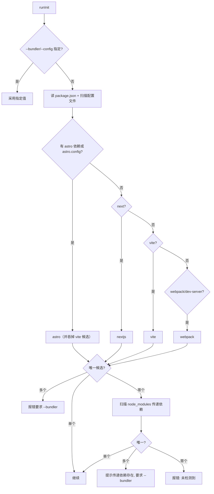
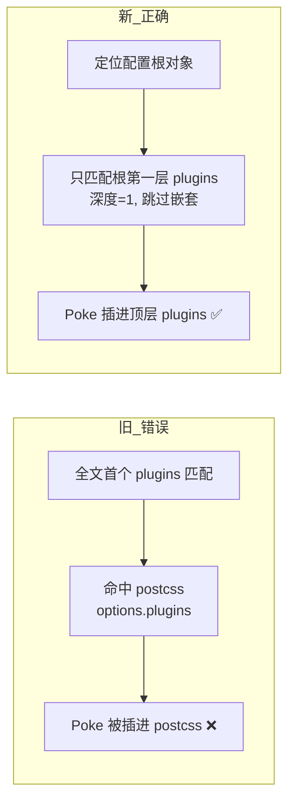
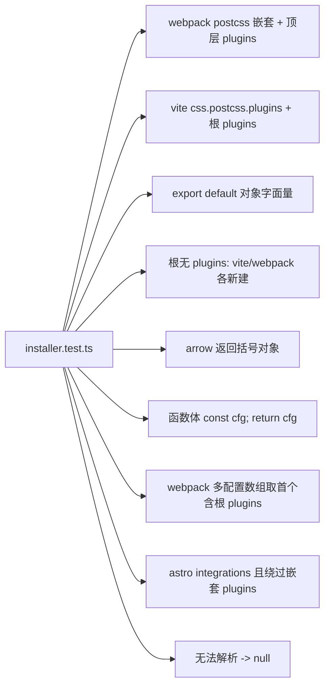

# Poke 安装器设计（INSTALLER-DESIGN）

安装器即 `poke-ai`（`packages/cli`，bin 亦提供别名 `poke`），`npx poke-ai` 触发。它探测 bundler、校验版本、装包、并把插件写进配置文件。本篇覆盖 **R4：修复「插错 plugins 数组」bug** 与 **R6：版本识别与不支持时的阻断**。

## 1. bundler 检测



多份同种配置文件时 `resolveConfigFile` 会列出候选并要求 `--config <path>` 指定。

## 2. 配置改写决策

```mermaid
flowchart TD
  R[读取配置文本] --> HAS{已含 @poke-dev/*?}
  HAS -->|是| SKIP[幂等：直接返回]
  HAS -->|否| IMP[插入 import/require]
  IMP --> KIND{bundler}
  KIND -->|vite| PV[patchPlugins(...,start)]
  KIND -->|webpack| PW[patchPlugins(...,end)]
  KIND -->|astro| PA[patchArrayProperty integrations]
  KIND -->|nextjs| PN[用 withPoke 包裹导出对象]
  PV & PW & PA --> WR[写回文件]
```

- vite 用 `start`（放数组首位，优先于 react 等），webpack 用 `end`。
- Next.js 不写数组，而是 `withPoke(nextConfig)` 包裹，并单独写 `instrumentation-client` 引入 `@poke-dev/nextjs/client`。

## 3. postcss 误插 bug：前 / 后对照

**旧实现**：`new RegExp('\\bplugins\\s*:\\s*\\[').exec(code)` —— 取全文**第一个** `plugins:` 命中，于是命中 `module.rules` 里 postcss-loader 的 `options.plugins`，把 Poke 插件塞进了 postcss 数组。



示例（webpack，postcss 嵌套在前、顶层 plugins 在后）：

```js
module.exports = {
  module: { rules: [{ use: [{ loader: 'postcss-loader', options: { plugins: ['postcss-import'] } }] }] },
  plugins: [existingPlugin()],
}
```

- 旧：`plugins: ['postcss-import', new PokeWebpackPlugin()]`（错，且 postcss 数组被污染）。
- 新：postcss 的 `['postcss-import']` 原样不动，Poke 追加到顶层 `[existingPlugin(), new PokeWebpackPlugin()]`。

## 4. 结构感知插入算法

核心在 `packages/cli/src/installer.ts`，纯函数、无副作用、可单测。

```mermaid
flowchart TD
  A[buildMask: 标记字符串/注释内的字符为无效] --> B[collectRootObjectOpens]
  B --> C{按锚点解析配置值}
  C -->|defineConfig arg / export default /\nmodule.exports =| D[objectsFromValue 递归]
  D --> E{值形态}
  E -->|{ obj }| F[直接作为根]
  E -->|[ obj, obj ]| G[数组各元素对象 -> 多根]
  E -->|(params) => expr / block| H[arrow 体: 表达式对象或 return 对象]
  E -->|function(){ return obj }| I[return 对象; 兼容 const cfg={};return cfg]
  F & G & H & I --> J[roots 按源码顺序去重]
```

```mermaid
flowchart TD
  K[patchArrayProperty code,name,expr,pos] --> L[遍历 roots: findDirectPropertySpan]
  L --> M{根有第一层 name 数组?}
  M -->|有| N[insertIntoArray 按 start/end 插入 -> 返回]
  M -->|无| O{该根完全无 name 键?}
  O -->|是, 第一个这样的根| P[createArrayInObject: 新建 name:[expr]]
  O -->|name 是非数组值| Q[跳过该根, 避免建重复键]
  N & P --> R[保留缩进/尾逗号风格]
  Q --> S[兜底: legacyInsert 首个匹配, 再不行新建]
```

关键设计点：

- **字符串/注释掩码**：`buildMask` 把引号与 `//`、`/* */` 内的字符标为无效，括号计数与关键字扫描只认真实代码，避免把字符串里的 `[` 当结构。
- **只认第一层**：`findDirectPropertySpan` 在根对象内维护深度计数，**仅当深度=1** 时才把 `name:` 当作目标属性；postcss/loader/`module.rules` 内的 `plugins` 深度≥2，天然被跳过。
- **解析多种导出形态**：`objectsFromValue`/`objectsFromArrowBody`/`returnObjectsInBody` 覆盖对象、数组多配置、`=> ({...})`、`=> { return {...} }`、`function(){...}`，并兼容「`const cfg = {...}; return cfg`」这种先赋值再返回的写法。
- **新建而非污染**：根上没有 `plugins` 时才在根对象头部 `plugins:[expr]`；`name` 是非数组值时不重复建键。
- **风格保持**：插入复用原有换行/缩进/尾逗号判断，产出可读、diff 友好的结果。
- **兜底降级**：所有根都无法理解时退回旧的首个匹配行为，保证异常配置仍可被处理（但典型 bug 场景必然走结构感知路径）。

## 5. 测试覆盖（`test/installer.test.ts`，10 例）



断言方式：目标串应出现在顶层数组（如 `plugins: [existingPlugin(), new PokeWebpackPlugin()]`），且被保护的嵌套数组**逐字不变**（如 `plugins: ['postcss-import']`），确保修复只作用于配置根。

## 6. 冒烟验证

用构建后的 `dist/index.js` 对含 postcss 嵌套的真实 webpack 配置跑 `--bundler webpack --no-install`，结果插件落在顶层 `plugins`、postcss 数组原样保留，与单测一致。

## 7. 版本门控（R6）

探测到 bundler 之后、安装/改写之前，`runInit` 调用 `packages/cli/src/version.ts` 做兼容性校验（仅 vite/webpack）。

```mermaid
flowchart TD
  D[detectBundler -> vite/webpack] --> C[checksForBundler]
  C -->|vite| CV[校验 vite]
  C -->|webpack| CW[校验 webpack + webpack-dev-server(若存在)]
  CV --> EV[evaluateDependency]
  CW --> EV
  EV --> SRC{已安装 node_modules 版本?}
  SRC -->|是| IMajor[取已安装主版本]
  SRC -->|否| RNG{package.json 范围能解析出主版本?}
  RNG -->|是| RMajor[取各 || 候选的最大主版本]
  RNG -->|否 latest/*/workspace:| UNK[unknown]
  IMajor --> STAT{与矩阵比较}
  RMajor --> STAT
  STAT -->|< floor| UNS[unsupported]
  STAT -->|> testedMax| UNT[untested]
  STAT -->|区间内| OK[ok]
  UNS --> BLOCK[阻断: 打印支持矩阵 + 退出1, 不改配置]
  BLOCK -->|带 --ignore-version / --force| WARN[降级为告警并继续]
  UNT & UNK --> WARN2[仅告警, 继续]
  OK --> GO[继续安装/改写]
```

支持矩阵（下限=本分叉实测支持面，上限=已验证到的最新主版本）：

| 依赖 | floor | testedMax | 缺失时 |
| --- | --- | --- | --- |
| vite | 4 | 8 | 必需：探测到却判不了版本 → 仅告警 |
| webpack | 4 | 5 | 必需：同上 |
| webpack-dev-server | 3 | 5 | 可选：未安装则跳过校验 |

判定要点：

- **已安装版本优先**：读 `node_modules/<dep>/package.json` 的 `version`（pnpm/yarn/npm 均可经符号链接解析），拿到确切主版本；没有安装才回退到 `package.json` 的声明范围。
- **范围解析取「最大候选主版本」**：按 `||` 拆分，取每个候选的首个整数（对 `3.0.0-beta.4` 这类预发布尾巴更稳健），只要**任一**候选能达标就放行——避免误伤 `^3 || ^5` 这类可升级到支持的写法。无法解析（`latest`/`*`/`workspace:*`/`catalog:`）判为 `unknown`，只告警。
- **只挡真正不兼容**：`unsupported` 才阻断；`untested`（比测试上限更新）与 `unknown`（判不出）都不阻断，符合「不确定时不误伤」。
- **阻断先于副作用**：校验在 `installPackage` 与 `patchXxxConfig` 之前执行，失败即退出，绝不把用不了的插件写进用户项目；`--ignore-version` 明确知情后才降级继续。
- 单测见 `test/version.test.ts`（13 例）；e2e 用 `--cwd` 指向含 `vite ^3` / `vite ^4` / `webpack-dev-server ^2` 的临时夹具，分别得到「退出1且配置未动 / 正常改写 / 阻断 dev-server」三种结果。

## 8. 传递依赖与 Vue CLI（R6 补强）

许多脚手架（`@vue/cli-service`、CRA 等）不把 `webpack` 列为**直接依赖**，而是藏在 `node_modules` 里；且配置入口不是 `webpack.config.*`（Vue CLI 是 `vue.config.js`）。旧逻辑只看直接依赖/配置文件，会对这类项目误报「未检测到」。

```mermaid
flowchart TD
  D[直接依赖+配置文件探测] --> Z{候选=0?}
  Z -->|否| GO[按原路径]
  Z -->|是| T[detectTransitiveBundler: 扫 node_modules/astro|next|vite|webpack|webpack-dev-server]
  T --> U{唯一?}
  U -->|是| W[判定为该 bundler（如 webpack）]
  U -->|多个| M[提示存在多个传递依赖, 要求 --bundler]
  W --> G[版本门控: 读已安装 node_modules 主版本]
  G --> V{vue.config.js 或 @vue/cli-service?}
  V -->|是| H[不自动改写: 打印 configureWebpack.plugins 手动接入指引]
  V -->|否| P[按标准 webpack.config 结构感知插入]
```

要点（`packages/cli/src/detect.ts` + `index.ts`）：

- **传递依赖兜底只作最后手段**：仅当直接依赖与配置文件都没命中（候选=0）时才扫 `node_modules`，因此一个声明了 `vite` 的项目不会因某个包顺带提升了 `webpack` 而误判。
- **版本门控天然适配**：`evaluateDependency` 已「已安装版本优先」，vue-cli 的 `webpack 4.46 / dev-server 3.11` 直接从 `node_modules` 判为 `ok`，无需声明范围。
- **Vue CLI 走友好兜底、不自动改写**：`isVueCliProject`（有 `vue.config.js` 或依赖 `@vue/cli-service`）命中时，`patchVueCliConfig` 只打印精确的 `configureWebpack.plugins: [new PokeWebpackPlugin()]` 片段并明确说明未改动文件，绝不盲写非 webpack 根的 `vue.config.js`。自 R7 起，`PokeWebpackPlugin` 已支持 `.vue` 源码注入（见 §9），故用户按此手动接入后 Vue2 老项目即可拾取。
- 单测见 `test/detection.test.ts`（8 例）；e2e 用真实 `@vue/cli-service` 项目 `--no-install` 跑通：识别 webpack → 版本达标放行 → 打印手动指引 → 退出码 0 → 目标项目 git 状态前后完全一致（零改动）。

## 9. webpack 侧 Vue SFC 注入（R7）

安装器只负责把 `PokeWebpackPlugin` 接进 webpack 配置；真正让 Vue2/`.vue` 可拾取的是插件内部的 `vue-source-loader`。要点：

- 依赖应用**自带**的 webpack/`vue-loader` 无需匹配 Vue 版本——注入用插件自带的 `@vue/compiler-sfc`/`-dom` 取偏移，`vue-source-loader.cjs`（`enforce:'pre'`，`test:/\.vue$/`）在每个 `.vue` 请求上幂等地给原生元素注入 `data-poke-source`/`-range`。
- 坑：`vue-loader` 会对主请求与 `?vue&type=` 子请求分别重解析并刷新 descriptor 缓存，且这些请求进入本 loader 时拿到的都是完整原始 SFC，所以不能靠 `resourceQuery` 跳过子请求（会丢属性）——每个请求都注入才对。
