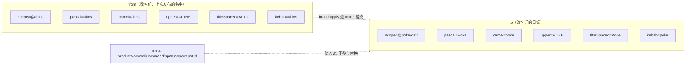
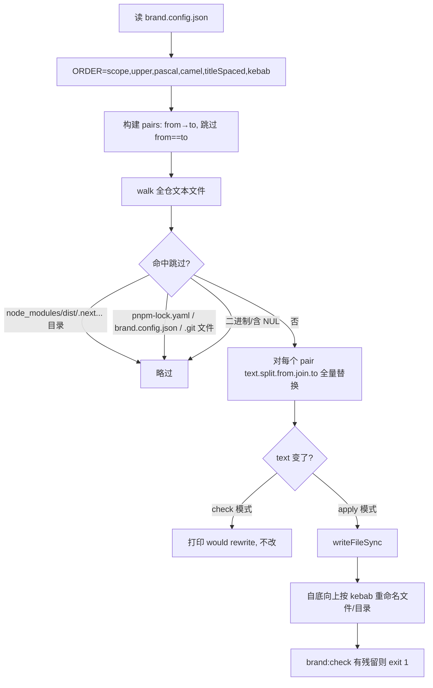
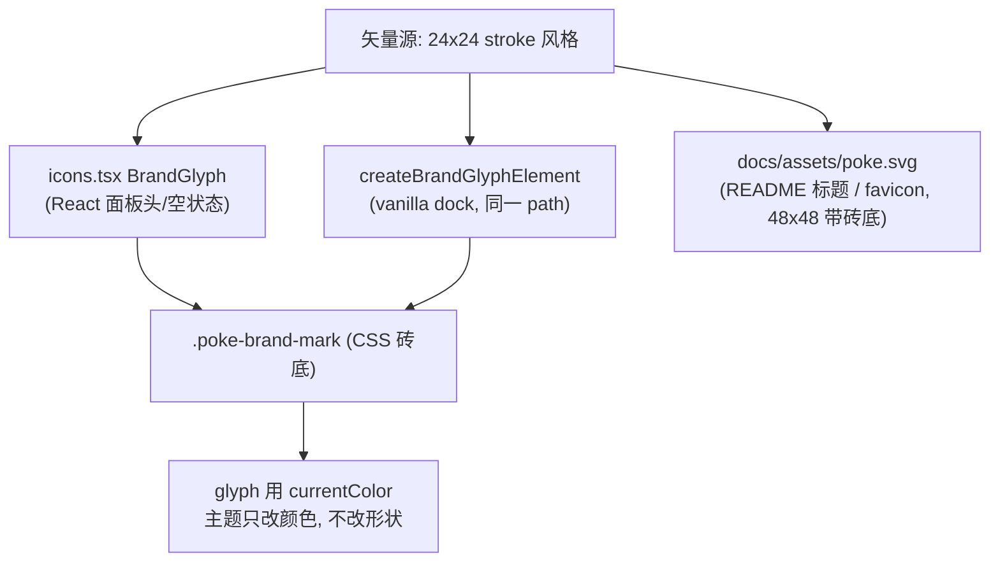
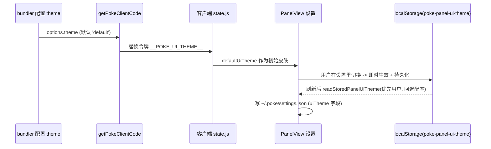

# Poke 主题与品牌（THEME-AND-BRANDING）

本篇覆盖两条需求：**R5 品牌可配置改名** 与 **R1 图标 / R2 三主题**。核心思想是把「叫什么」收敛到一个 JSON，把「长什么样」收敛到一套 CSS 变量 + 一份矢量源。

## 1. 品牌配置模型（单一真源）

`brand.config.json`（仓库根）是**唯一**品牌源。它不描述代码，只描述「从什么名字改成什么名字」的映射，以及供元信息展示的产品名。



六个 token 各对应一类标识符形态，改一次即覆盖全仓：

| token | 语义 | 典型落点 |
| --- | --- | --- |
| `scope` | npm 作用域 | `"@ai-ins/core"` → `"@poke-dev/core"` |
| `pascal` | 导出符号/类名 | `AiInsPlugin` → `PokePlugin` |
| `camel` | 变量/函数/属性 | `aiInsOptions` → `pokeOptions` |
| `upper` | 环境变量、令牌 | `AI_INS_ROOT` / `__AI_INS_*__` → `POKE_*` / `__POKE_*__` |
| `titleSpaced` | 带空格展示名 | `AI Ins` → `Poke` |
| `kebab` | 目录/文件名/CSS 前缀/HTTP 路由 | `ai-ins-dom.js` / `.ai-ins-` / `/__ai-ins/*` → `poke` |

## 2. 改名 codemod 流程（`scripts/brand.mjs`）



关键约束（也是踩过的坑）：

- **替换顺序**：`ORDER` 先 `scope` 后 `kebab`。若先替 `ai-ins`→`poke`，`@ai-ins` 会被拆成 `@poke`，作用域丢失。
- **`.git` 必须跳过**：worktree 里 `.git` 是**文件**（gitdir 指针），目录级跳过拦不住它，一旦被当文本重写会**损坏 worktree**。故同时写进 `SKIPPED_FILES` 并在 `walk()` 里加 `entry.name !== '.git'` 兜底。
- **`brand.config.json` 自身跳过**：否则 `from` 段会被就地改掉，映射自毁。
- **幂等 & 可校验**：`pnpm brand:check` 只扫描不写，`changedFiles>0` 即退出码 1，作为「改名是否干净」的门禁。
- **发布前换名三步**：改 `to`（把 `from` 填成上一次的名字）→ `pnpm brand:apply` → `pnpm install && pnpm build && pnpm test` 验证并提交。

## 3. 品牌图标（R1）

一份矢量，三种落地，永不错位：**四段选框**框住**一个仍在颤动的触点**——即「拾取元素 + 点回源码」的心智。



- `brandBracketPaths` 是四条 `M...h/v` 选框路径，`brandRing`(r=2.75) 为颤动圈、`brandDot`(r=1.25) 为触点；React 与 vanilla dock 共用同一组常量，避免两套实现漂移。
- 砖底 `.poke-brand-mark` 在明暗两种模式下都保持深色（像 app 图标），glyph 继承 `currentColor`，因此**换主题=换色不换形**。
- `poke-brand-ring` 用 `poke-brand-pulse` 关键帧无限颤动；面板 `data-busy="true"`（有会话在跑）时提速，形成「工作中」的呼吸感。

## 4. 三主题皮肤（R2）

两个**正交**维度叠加决定外观：`data-theme` 管**明暗**，`data-ui-theme` 管**皮肤**。皮肤靠覆盖 CSS 设计变量实现，不切换组件树，因此不会重挂载丢状态。

```mermaid
stateDiagram-v2
  direction LR
  [*] --> default
  default --> tech: 霓虹强调色/发光描边
  tech --> cli: 等宽/方角/磷光绿
  cli --> default: 回到中性
  default --> default: 写 localStorage + 同步用户设置
  tech --> tech: 写 localStorage + 同步用户设置
  cli --> cli: 写 localStorage + 同步用户设置
```

| 皮肤 | 设计意图 | 代表 token 覆盖 |
| --- | --- | --- |
| `default` | 现有中性（ChatGPT 式）外观，不改任何变量 | —— |
| `tech` | 科技：霓虹青色强调、发光边、玻璃质感；仅重染强调色与阴影，布局不动 | `--poke-accent:#22d3ee`、primary 按钮外发光、brand 砖底转青、ring 3.6s(忙 0.9s) |
| `cli` | 终端：等宽、方角、石墨底磷光绿；**忽略明暗**（`color-scheme:dark`） | `--poke-radius-*`→2/3/4px、整套磷光绿变量、`font-family:var(--poke-mono)`、`text-shadow` 辉光、ring 用 `steps(2)` |

注入与持久化链路：



- `theme?: 'cli'|'default'|'tech'` 加在 `PokePluginOptions`，经 `index.ts` 的 `.replace('__POKE_UI_THEME__', JSON.stringify(options.theme ?? 'default'))` 注入为 `defaultUiTheme`，是**起始皮肤/默认值**。
- 运行时以 `readStoredPanelUiTheme(defaultUiTheme)` 为准：`localStorage` 有用户选择就用它，否则回退配置值；dock 重建时复制同一皮肤，使品牌标记随主题发光(tech)或变方(cli)。
- `uiTheme` 同时进入用户级设置（`user-settings.ts` 的 `stringKeys`、`api.js` 的字段映射 `poke-panel-ui-theme→uiTheme`），跨会话保留。
- i18n 各语言补 `settings.uiTheme` / `uiThemeDefault` / `uiThemeTech` / `uiThemeCli` 四个 key（`zh-CN` 为真源，`i18n.test.ts` 强制 key 集一致）。
- `prefers-reduced-motion: reduce` 下 tech/cli 的 ring 动画关闭，尊重系统偏好。
